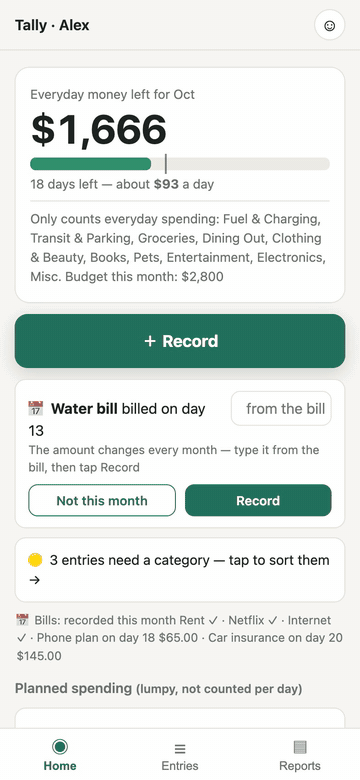
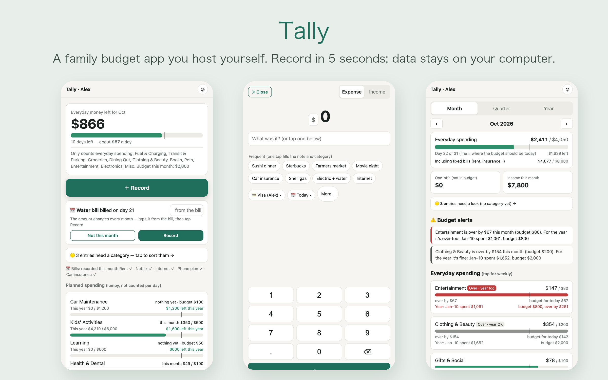

# Tally

**A family budget app you host yourself.** Everyone records spending on their own phone in about five seconds; Tally sorts it into categories, keeps an eye on the budget, and keeps all the data on a computer in your home.

[中文说明](README.zh.md)

<p align="center"></p>

## Why

- **Recording has to be faster than forgetting.** A big keypad, a one-line note, done. Your most frequent notes show up as one-tap buttons.
- **It learns your words.** "Costco", "lunch with Sam", "piano lesson" land in the right category. When you correct one, it remembers.
- **"How much can we still spend this month?"** is the first thing you see. Everyday spending is shown per day. Lumpy costs like kids' activities and travel are tracked against the year, so one big month doesn't set off false alarms.
- **The data is yours.** One SQLite file on your own computer, with a full backup copy made every day. No account, no cloud, no ads, no tracking.
- **No dependencies.** Plain Node.js with its built-in SQLite. There are no `npm install` packages to keep updated.

## What it does



| | |
|---|---|
| **Record** | Expense / income / transfer · multiple currencies with your own exchange rates · works offline (queued on the phone, uploads later) · optional details per category (where, with whom, coach…) |
| **Auto-categorize** | Starter keywords for 25 categories (English or Chinese) + learns from your history and corrections · notes it can't place are marked "needs a category", and you sort them with one tap |
| **Budgets** | Monthly budget per category · pace line ("where you should be today") · alerts that distinguish "over this month but fine for the year" from "over for the year too" |
| **Reports** | Month (weekly breakdown) · quarter (vs. last quarter, which months went over) · year (by category, account, person; one-off big purchases kept separate) |
| **Recurring bills** | A reminder card on the due day; one tap records it. Bills with amounts that change (utilities) ask for the amount |
| **Family roles** | Admin · family member (sees everything) · recorder (records, sees only their own — e.g. grandparents) · personal (a kid with an allowance) · each person has a PIN |
| **Languages** | English and 中文, switchable per phone |

## Quick start (Mac)

You need **Node.js 22.13 or newer** (`node -v` to check; install with `brew install node` or from [nodejs.org](https://nodejs.org)).

```sh
git clone https://github.com/bohemianwp/tally.git
cd tally
npm start
```

Open **http://localhost:8787** and set up your household (about one minute).

To have Tally start by itself every time you log in:

```sh
scripts/install-mac.sh          # undo with: scripts/install-mac.sh --uninstall
```

Tally also runs on Linux and Windows (`npm start`). The auto-start script is Mac-only.

### Try it with demo data first

```sh
npm run demo                              # makes data/demo-en.db and data/demo-zh.db
TALLY_DB=data/demo-en.db npm start        # every demo PIN is 1234
```

The demo uses its own database file, so it never touches your real one.

## Use it on your phone

By default Tally listens only on the computer it runs on, which is the safe choice. To reach it from your phones, use **[Tailscale](https://tailscale.com)**, a free private network between your own devices:

1. Install Tailscale on the computer and on each phone, and sign in with the same account.
2. On the computer, run: `tailscale serve --bg 8787`
3. It prints an address like `https://your-mac.your-tailnet.ts.net`. Open it on the phone, then use **Share → Add to Home Screen**.

Only devices signed in to your Tailscale can open that address. It works from anywhere: at home, at the store, or abroad.

*Home Wi-Fi only, without Tailscale:* start with `HOST=0.0.0.0 npm start` and open `http://<computer's IP>:8787` on the phone. This uses plain HTTP, so only do it on a network you trust.

## Your data

- Everything is in `data/tally.db` (one SQLite file). Copy it to back it up, or open it with any SQLite tool.
- A full copy is saved to `backups/` once a day. Old copies are never deleted automatically.
- Deleting an entry only hides it (soft delete), so it can be recovered from the database.
- PINs are stored hashed (scrypt), never in plain text. Five wrong PINs lock that person for 15 minutes.

## Settings

| Variable | Default | |
|---|---|---|
| `PORT` | `8787` | |
| `HOST` | `127.0.0.1` | `0.0.0.0` to allow other devices on your network |
| `TALLY_DB` | `data/tally.db` | use a different database file |

Budgets, bills, currencies and family members are managed in the app under **Me** (admin). You can add categories and accounts there too, but renaming or removing them isn't possible yet.

## Updating

```sh
git pull
```

Then restart Tally (or log out and back in on the Mac if you used `install-mac.sh`). If a new version changes the database layout, Tally upgrades your file automatically on start, after saving a copy of the old one to `backups/`.

## Development

```sh
npm test                    # end-to-end test on a throwaway database
node scripts/check_i18n.js  # every on-screen string exists in both languages
scripts/screenshots.sh      # phone-sized screenshots of the demo (needs Google Chrome)
```

- `server.js`: the web server and API
- `lib.js`: database, categorization, dashboard math
- `public/`: the phone app (plain HTML/CSS/JS, no build step) · `public/i18n.js` holds all the text
- `templates/`: starter categories and keywords for each language

To add a language, copy the `en` block in `public/i18n.js` and add `templates/categories.<lang>.json`.

## License

MIT
