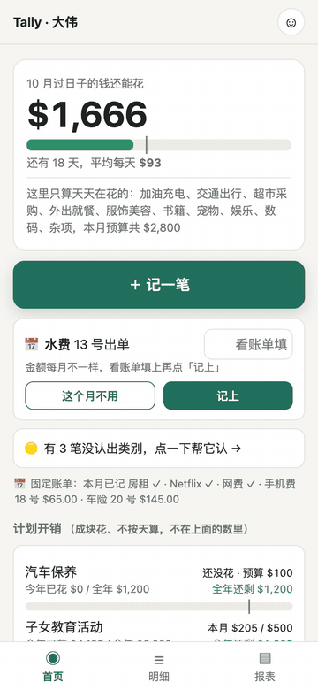
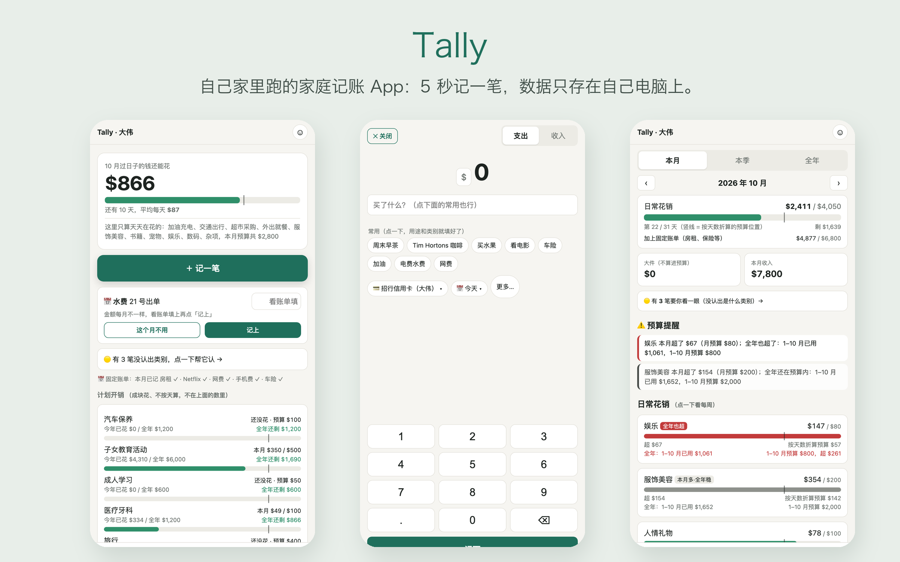

# Tally

**跑在自己家里的家庭记账 App。** 全家每人用自己的手机，5 秒记一笔；Tally 自动分类、盯着预算，数据只存在你家里的一台电脑上。

[English](README.md)

<p align="center"></p>

## 为什么做它

- **记账要比忘掉还快。** 大键盘按金额，写一句「买了什么」，就记完了。常记的那几样会变成按钮，点一下就填好。
- **它会学你的说法。** 「Costco 买菜」「和小李吃饭」「钢琴课」会自动分到对的类别。你改过一次，下次它就记住了。
- **打开第一眼看到「这个月还能花多少」。** 天天在花的钱按天算；孩子兴趣班、旅行这种成块花的钱按全年算，所以某个月花多了不会乱报警。
- **数据是你自己的。** 就是你电脑上的一个数据库文件，每天自动备份一份。不用注册账号，不上云，没有广告，不收集任何信息。
- **零依赖。** 只用 Node.js 自带的功能（包括自带的 SQLite 数据库），不用 `npm install` 装一堆第三方包，也就不用操心它们更新。

## 能做什么



| | |
|---|---|
| **记账** | 支出 / 收入 / 转账 · 多币种，汇率自己定 · 断网也能记（先存在手机里，连上再传） · 每个类别可以补几句细节（在哪、和谁、哪个教练……） |
| **自动分类** | 25 个类别自带关键词（中文或英文） + 从你记过的账和改过的类别里学 · 认不出来的标成「待确认」，点一下就归好类 |
| **预算** | 每个类别一个月预算 · 进度竖线（「今天应该花到哪」） · 提醒分两种：「本月多了但全年还稳」和「全年也超了」 |
| **报表** | 本月（可看每周） · 本季（和上季比，哪几个月超了） · 全年（按类别、账户、人；一次性大件单独算） |
| **固定账单** | 到期那天首页弹一张卡片，点一下就记上；每月金额不一样的（比如水电）让你填个数 |
| **家人身份** | 管理员 · 家庭成员（全都能看） · 记账员（只看自己记的，适合帮忙记账的老人） · 个人账户（有零花钱的孩子） · 每人一个密码 |
| **语言** | 中文、English，每台手机自己切换 |

## 快速开始（Mac）

需要 **Node.js 22.13 或更新的版本**。终端里打 `node -v` 可以查版本；没装的话用 `brew install node` 装，或者到 [nodejs.org](https://nodejs.org) 下载。

```sh
git clone https://github.com/bohemianwp/tally.git
cd tally
npm start
```

浏览器打开 **http://localhost:8787**，按提示设置你的家，大约一分钟。

想让 Tally 每次开机登录后自己启动：

```sh
scripts/install-mac.sh          # 撤销：scripts/install-mac.sh --uninstall
```

Linux 和 Windows 上也能跑（`npm start`），只是自动启动的脚本只有 Mac 版。

### 先用演示数据试试

```sh
npm run demo                              # 生成 data/demo-zh.db 和 data/demo-en.db
TALLY_DB=data/demo-zh.db npm start        # 演示账号的密码都是 1234
```

演示数据用的是单独的数据库文件，不会碰你真正的账。

## 在手机上用

Tally 默认只让运行它的那台电脑自己打开，这样最安全。要让手机连上，推荐用 **[Tailscale](https://tailscale.com)**，它免费，能把你自己的几台设备连成一个私人网络：

1. 电脑和每台手机都装上 Tailscale，登录同一个账号。
2. 在电脑的终端里运行：`tailscale serve --bg 8787`
3. 它会显示一个网址，像 `https://你的电脑名.xxx.ts.net`。在手机上打开这个网址，再点**分享 → 添加到主屏幕**。

只有登录了你这个 Tailscale 账号的设备才能打开这个网址。在家、在超市、在国外都能用。

*只在家里 Wi-Fi 用、不装 Tailscale 的话*：用 `HOST=0.0.0.0 npm start` 启动，手机打开 `http://电脑的IP:8787`。这样走的是不加密的连接，只在你信得过的网络上这么用。

## 你的数据

- 全部数据都在 `data/tally.db` 这一个文件里。要备份就复制这个文件，用任何 SQLite 工具都能打开。
- 每天会自动往 `backups/` 里存一份完整备份，旧的备份从不自动删除。
- 删掉的账只是隐藏起来，数据库里还在，能找回来。
- 密码加密保存（scrypt），不存明文。同一个人连续输错 5 次，锁 15 分钟。

## 设置

| 变量 | 默认 | |
|---|---|---|
| `PORT` | `8787` | 端口 |
| `HOST` | `127.0.0.1` | 改成 `0.0.0.0` 就能让同一网络里的其他设备连上 |
| `TALLY_DB` | `data/tally.db` | 换一个数据库文件 |

预算、固定账单、币种、家人，都在 App 里的「我的」页面改（管理员才能改）。类别和账户也能在那里新加，但暂时还不能改名或删除。

## 更新

```sh
git pull
```

然后重启 Tally（用了 `install-mac.sh` 的话，在 Mac 上注销再登录一次）。新版本如果改了数据库的结构，Tally 启动时会自动把你的数据库升级，升级前先往 `backups/` 里存一份旧的。

## 开发

```sh
npm test                    # 在一个临时数据库上把主要功能从头到尾跑一遍
node scripts/check_i18n.js  # 检查界面上每句话中英文都有
scripts/screenshots.sh      # 给演示数据截手机尺寸的图（需要装 Google Chrome）
```

- `server.js`：网页服务器和接口
- `lib.js`：数据库、自动分类、看板计算
- `public/`：手机端（纯 HTML/CSS/JS，不用打包） · 界面上所有的字都在 `public/i18n.js`
- `templates/`：每种语言的初始类别和关键词

想加一种语言：复制 `public/i18n.js` 里的 `en` 那一块翻译好，再加一个 `templates/categories.<语言>.json`。

## 关于这个项目

Tally 是我家每天在用的 App，我按自家的需要更新它。欢迎在 [Issues](https://github.com/bohemianwp/tally/issues) 里提问、报 bug；功能建议不保证都能做。

## 许可

MIT
